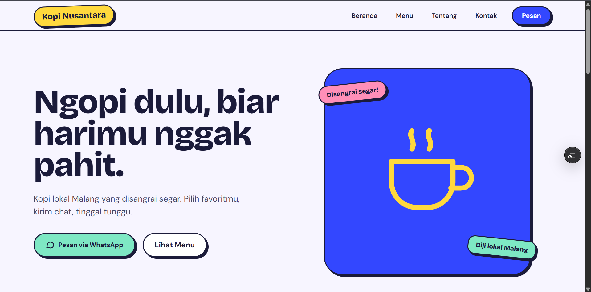

# Kopi Nusantara

Website toko kopi lokal dengan katalog menu dan pemesanan lewat WhatsApp. Pelanggan memilih menu, menekan tombol pesan, dan WhatsApp terbuka dengan pesan yang sudah berisi nama produk.

**Demo langsung:** https://toko-demo-git-desain-fun-goyy1.vercel.app/



> Ini proyek demo untuk portofolio. Nama usaha, menu, harga, alamat, dan nomor WhatsApp adalah contoh fiktif.

## Masalah yang diselesaikan

Banyak usaha kecil menerima pesanan lewat chat, tetapi pelanggan harus mengetik ulang menu dan harga, dan pemilik usaha menjawab pertanyaan yang sama berulang kali. Website ini menampilkan menu dengan rapi dan menyiapkan pesan pemesanan secara otomatis, sehingga pesanan lebih cepat dan jelas.

## Fitur

- Halaman utama dengan hero, katalog 8 menu, bagian tentang kami, dan footer berisi jam buka
- Halaman detail untuk setiap produk
- Tombol **Pesan via WhatsApp** dengan pesan otomatis berisi nama produk
- Tampilan responsif dengan menu khusus HP
- Gaya visual pop yang ekspresif: garis tebal, warna berani, dan kartu yang sedikit miring

## Teknologi

- [Next.js](https://nextjs.org) (App Router) dan React
- TypeScript
- Tailwind CSS
- Font Bricolage Grotesque dan DM Sans (`next/font`)
- Dihosting di Vercel

## Menjalankan di komputer sendiri

Butuh Node.js versi LTS.

```bash
git clone https://github.com/GoyyPW/toko-demo.git
cd toko-demo
npm install
npm run dev
```

Buka [http://localhost:3000](http://localhost:3000).

## Struktur proyek

```
toko-demo/
├─ app/
│  ├─ page.tsx               # halaman utama
│  └─ produk/[slug]/page.tsx # halaman detail produk
├─ components/               # header, hero, kartu produk, tentang, footer, tombol WhatsApp
├─ data/products.ts          # daftar produk
└─ lib/whatsapp.ts           # nomor WhatsApp dan pembuat link pesan
```

## Menyesuaikan untuk usaha lain

Website ini dibuat agar mudah dipakai ulang:

- **Produk:** ubah isi `data/products.ts` (nama, harga, deskripsi, kategori).
- **Nomor WhatsApp:** ubah `WA_NUMBER` di `lib/whatsapp.ts` (awali dengan 62, tanpa tanda + atau 0).
- **Warna dan font:** diatur di `app/globals.css` dan `app/layout.tsx`.
- **Foto asli:** ganti gambar placeholder di kartu produk dan hero.

## Ingin website seperti ini untuk usahamu?

Saya menerima pembuatan website dan sistem kecil untuk UMKM, lengkap dengan desain yang disesuaikan dengan karakter usahamu.

- Kontak: Email : yog2987@gmail.com atau WA : 081515679413
- Portofolio lain: https://github.com/GoyyPW/stok-demo
